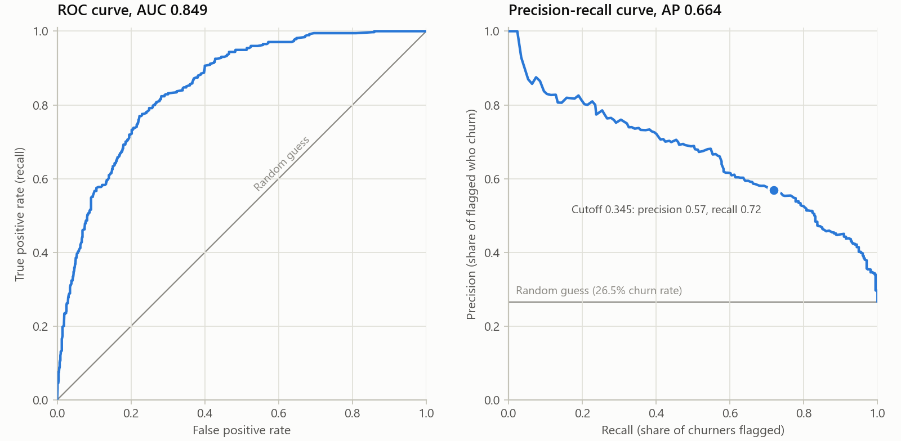
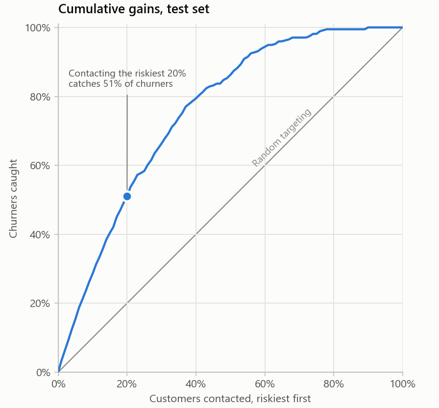
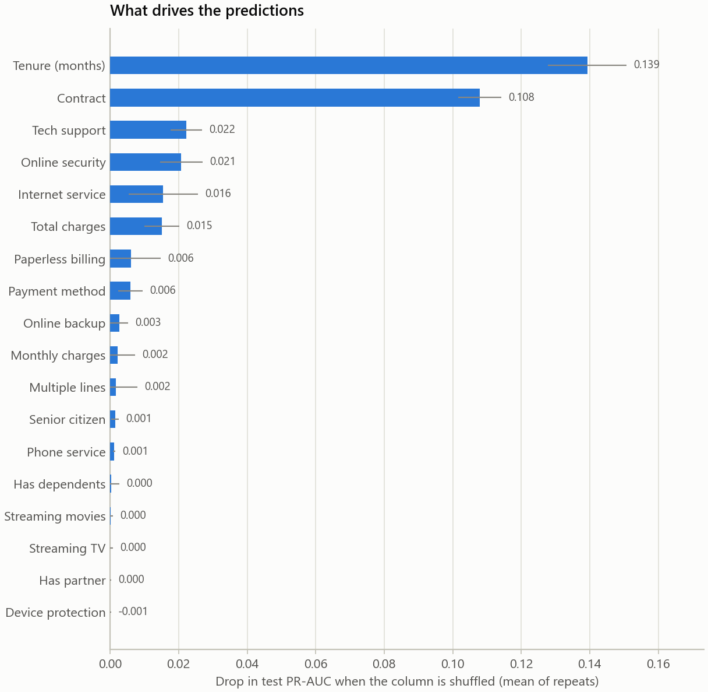

# Telco Churn Classifier

Predicts which telecom customers are likely to cancel their service (churn). It is trained on the public [IBM Telco Customer Churn dataset](https://github.com/IBM/telco-customer-churn-on-icp4d): 7,043 customers, of whom 26.5% churned.

It includes:

- a training script that compares three model families and keeps the best one;
- a command-line tool that scores a CSV of customers;
- a REST API that scores customers one at a time or in batches.

## Results

Everything below is measured on 1,409 customers held out from training and used only once, at the end.

| Measure | Value |
|---|---|
| ROC-AUC | **0.849** |
| PR-AUC (average precision) | **0.664** (a random guess scores 0.265) |
| Flagging cutoff | 0.345 probability |
| Precision at the cutoff | 0.569: about 4 in 7 flagged customers do churn |
| Recall at the cutoff | 0.719: 72% of churners are flagged |
| F1 at the cutoff | 0.635 |
| Accuracy | 0.781 (always predicting "no churn" scores 0.735) |
| Targeting | Contacting the riskiest 20% of customers catches **51%** of churners |

The selected model is **XGBoost**. Five-fold cross-validation PR-AUC on the training set:

| Model | PR-AUC | ROC-AUC |
|---|---|---|
| Logistic regression | 0.664 ± 0.013 | 0.846 ± 0.012 |
| Random forest | 0.666 ± 0.018 | 0.848 ± 0.010 |
| XGBoost | 0.672 ± 0.022 | 0.850 ± 0.011 |

The strongest drivers are tenure and contract type, followed by tech support, online security and internet service. Short-tenure, month-to-month customers on fiber without security or support add-ons churn the most.







The confusion matrix and calibration charts are in [reports/figures](reports/figures). All numbers are in [reports/metrics.json](reports/metrics.json).

## Quick start

Run these from the project folder. The examples use Windows PowerShell, and the same commands work in any shell.

```bash
python -m pip install -r requirements.txt
```

```bash
python -m churn.train
```

The first run downloads the dataset (about 1 MB) to `data/raw/`. A full run takes about a minute on a 16-core laptop. It writes:

- `models/churn_model.joblib`: the pipeline, the cutoff and metadata;
- `reports/`: metrics, charts and dashboard tables;
- `data/processed/holdout.csv`: the test customers.

```bash
python -m churn.predict --input data/processed/holdout.csv --output reports/holdout_predictions.csv
```

```bash
python -m uvicorn churn.api:app --reload
```

Then open http://127.0.0.1:8000/docs to try the API in the browser.

```bash
python -m pytest
```

## Scoring a CSV

`python -m churn.predict --input customers.csv --output predictions.csv [--threshold 0.4]`

The input needs the dataset's 18 feature columns:

- `SeniorCitizen` (0 or 1), `Partner`, `Dependents`, `tenure`;
- `PhoneService`, `MultipleLines`, `InternetService`;
- `OnlineSecurity`, `OnlineBackup`, `DeviceProtection`, `TechSupport`, `StreamingTV`, `StreamingMovies`;
- `Contract`, `PaperlessBilling`, `PaymentMethod`, `MonthlyCharges`, `TotalCharges`.

Other columns such as `customerID`, `gender` and `Churn` are ignored. `customerID` is copied to the output when present. A blank `TotalCharges` is allowed: for brand-new customers it is filled with tenure × monthly charges.

The output has three columns: `customerID`, `churn_probability` (0 to 1) and `churn_prediction` (1 when the probability reaches the cutoff). Use `--threshold` to flag more customers (lower cutoff) or fewer (higher cutoff). The precision and recall at every cutoff are in `reports/dashboard/thresholds.csv`.

## Prediction API

| Endpoint | What it does |
|---|---|
| `GET /health` | Shows which model is loaded, its cutoff and when it was trained |
| `POST /predict` | Scores one customer |
| `POST /predict/batch` | Scores up to 1,000 customers: `{"customers": [...]}` |

Invalid values, such as `"Contract": "Weekly"` or a negative `tenure`, are rejected with HTTP 422 and a message that lists the allowed values. Example from PowerShell:

```powershell
$customer = @{
  SeniorCitizen = 0; Partner = "No"; Dependents = "No"; tenure = 2
  PhoneService = "Yes"; MultipleLines = "No"; InternetService = "Fiber optic"
  OnlineSecurity = "No"; OnlineBackup = "No"; DeviceProtection = "No"; TechSupport = "No"
  StreamingTV = "Yes"; StreamingMovies = "Yes"; Contract = "Month-to-month"
  PaperlessBilling = "Yes"; PaymentMethod = "Electronic check"; MonthlyCharges = 95.5
}
Invoke-RestMethod http://127.0.0.1:8000/predict -Method Post -ContentType "application/json" -Body ($customer | ConvertTo-Json)
```

The response:

```json
{"customerID": null, "churn_probability": 0.7868, "churn_prediction": true, "threshold": 0.345, "model": "xgboost"}
```

By default the API serves `models/churn_model.joblib`. To serve another bundle, set the `CHURN_MODEL_PATH` environment variable.

## How it works

1. **Data.** The 11 blank `TotalCharges` values all belong to customers with zero tenure, so they are filled with 0. `gender` is deliberately left out of the features: it carries almost no churn signal in this data, and leaving it out keeps retention targeting from depending on gender.
2. **Features.** Three columns are added inside the saved pipeline, so the CLI and the API clean data exactly as training does:
   - the number of add-on services;
   - the average monthly spend;
   - a tenure band.
   Numbers are scaled and categories one-hot encoded.
3. **Split.** A stratified 80/20 train/test split, with a fixed seed.
4. **Model search.** Logistic regression, random forest and XGBoost are each tuned with five-fold cross-validation and ranked by PR-AUC. PR-AUC suits a 26.5% minority class better than accuracy. Logistic regression is kept instead whenever it comes within 0.005 PR-AUC of the best, because it is easier to explain. Here XGBoost won by 0.008.
5. **Cutoff.** The flagging threshold maximizes F1 on out-of-fold predictions from the training set. Class imbalance is handled by this cutoff rather than by reweighting or resampling, so the probabilities stay calibrated. `reports/figures/calibration.png` shows predicted and observed churn rates lining up.
6. **Evaluation.** The test set is scored once. Permutation importance measures how much test PR-AUC drops when each input column is shuffled.

## Project layout

```
churn/
  config.py     paths, data URL, column lists, seeds
  data.py       download, validation, X/y split
  features.py   feature engineering + preprocessing pipeline
  train.py      model search, selection, cutoff, saving   (python -m churn.train)
  evaluate.py   metrics, gains, calibration, importance, segment churn rates
  report.py     metrics.json, CSV tables, PNG charts
  predict.py    load the model and score a CSV            (python -m churn.predict)
  api.py        FastAPI service                           (uvicorn churn.api:app)
tests/          unit tests plus an end-to-end run on the real data
data/raw/       downloaded dataset (not edited)
models/         saved model bundle
reports/        metrics.json, model_comparison.csv, figures/, dashboard/
```

## Retraining and experiments

`python -m churn.train` overwrites `models/` and `reports/`. Both are reproducible from the fixed seeds.

`python -m churn.train --quick` runs a small search in about 15 seconds, which is useful for checking changes. It also overwrites the saved model, so point it elsewhere with `--out-dir`:

```bash
python -m churn.train --quick --out-dir experiments/quick
```

Model settings, the selection margin and the column lists live in `churn/config.py`. The search spaces are defined in `churn/train.py`.
